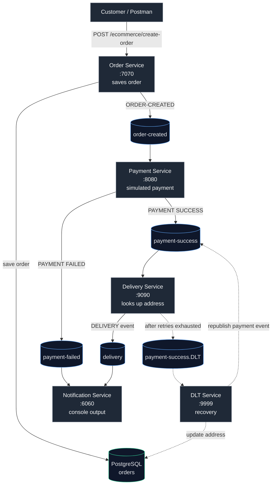

# kafka-event-driven-microservices
Asynchronous microservices communication with Apache Kafka. Built with Java, Spring Boot, and an event-driven architecture for resilient, scalable systems.

# 🛒 Kafka Event-Driven Microservices

An e-commerce order workflow built with **five independent Spring Boot microservices** that communicate asynchronously through **Apache Kafka**. It demonstrates producers, consumers, retries, and dead-letter handling in a realistic order → payment → delivery → notification flow.

## 🏗️ Architecture



## 🔄 Event Flow

1. **Order Service** exposes `POST /ecommerce/create-order`, saves the order to PostgreSQL, and publishes an `ORDER-CREATED` event to the `order-created` topic.
2. **Payment Service** consumes `order-created`, simulates a payment result, and publishes to either `payment-success` or `payment-failed`.
3. **Delivery Service** consumes `payment-success`, looks up the order's delivery address, and publishes a delivery event to `delivery`.
4. **Notification Service** consumes `payment-failed` and `delivery` events. Notifications are currently printed to the console (no email/SMS provider yet).
5. **DLT Service** handles unprocessable delivery messages. After the Delivery Service exhausts its retries, the message lands in `payment-success.DLT`. The DLT Service updates the order address and republishes the payment event so delivery can try again.

## 📨 Kafka Topics

| Topic | Producer | Consumer |
|---|---|---|
| `order-created` | Order Service | Payment Service |
| `payment-success` | Payment Service, DLT Service | Delivery Service |
| `payment-failed` | Payment Service | Notification Service |
| `delivery` | Delivery Service | Notification Service |
| `payment-success.DLT` | Delivery Service (on retry exhaustion) | DLT Service |

## 🧰 Tech Stack

- Java <17>, Spring Boot
- Apache Kafka (Spring Kafka)
- PostgreSQL
- Maven (each service has its own Maven wrapper)

## 🔌 Services and Ports

| Service | Port |
|---|---|
| Order Service | `7070` |
| Payment Service | `8080` |
| Notification Service | `6060` |
| Delivery Service | `9090` |
| DLT Service | `9999` |

## 🚀 Running Locally

### Prerequisites
- JDK <25.0.3>
- Apache Kafka running on `localhost:9092`
- PostgreSQL running locally (used for order persistence)

### Steps

1. Start Kafka and PostgreSQL.
2. Each service is an independent Maven project (there is no top-level aggregator). Start each one from its own folder:

```bash
   # Linux / macOS
   ./mvnw spring-boot:run

   # Windows
   mvnw.cmd spring-boot:run
```

3. Start all five services: order, payment, delivery, notification, and DLT.

### Try it out

```bash
curl -X POST http://localhost:7070/ecommerce/create-order \
  -H "Content-Type: application/json" \
  -d '{ <your request body> }'
```

Then watch the console logs of the other services to follow the event through the pipeline.

## 📚 What This Project Demonstrates

- Kafka producers and consumers
- JSON event serialization
- Consumer groups
- Persistence with PostgreSQL
- Retry handling and dead-letter topics (DLT)

## ⚠️ Limitations

This is a learning/demo project, not a production-ready commerce system:
- Payment outcomes and order values are simulated.
- DLT recovery uses a fixed address.
- Notifications are printed to the console only.

## 🔮 Possible Improvements

- Real email/SMS notifications
- Docker Compose setup for Kafka, PostgreSQL, and all services
- Integration tests with embedded Kafka or Testcontainers
- A top-level build or parent POM
